# Phase 11.2.4-C 验收报告 — B1 Statistics API + B2 Review Insights 页面

> 验收日期：2026-11-14  
> 分支：`phase11/dashboard`  
> HEAD：`27e3a41161cfa86ee2956ba0b3626a2bcc71eec7`  
> 验收对象：B1 Dashboard 只读统计 API、B2 Vue `/insights` 页面、真实 MySQL 验收数据、真实浏览器端到端流程、安全边界与只读 SQL 计划  
> 最终结论：**PASS WITH WARNINGS（通过，附 5 项非阻塞警告 / 验证限制）**

---

## 1. 验收结论

### 1.1 总体判定

**PASS WITH WARNINGS。**

Phase 11.2.4-C 的核心验收目标已完成：

- B1 两个只读统计接口在真实 MySQL 验收库上返回稳定、可核对的结果；
- B2 `/insights` 页面在真实浏览器中可导航、筛选、排序、切换 DAY/WEEK、改变每页数量、显示空状态与失败重试；
- 默认统计数字与 B1 报告及验收库原始数据一致；
- 未知枚举、计数不一致、无报告任务等异常数据没有被静默丢弃或伪造；
- loopback 访问边界、非 loopback 拒绝、Forwarded/Host 伪造、编码/矩阵/反斜杠路径、错误体脱敏均通过；
- 验收数据库在验收前后行数、校验和完全一致，未执行任何 DDL/DML；
- 前端 `type-check`、`lint:check`、`test:unit`、`build` 全部通过；
- 后端完整单元测试与 MySQL 集成测试全部通过，验收库定向 IT 12/12 通过；
- 未发现 P0 / P1 / P2 缺陷，未修改任何源代码、测试、配置或既有报告。

存在以下非阻塞警告和验证限制：

1. **真实 UI 翻页未验证（NOT VERIFIED）**：验收库只有 6 行 Review，页面最小每页数量为 10，无法在 UI 上产生第 2 页；后端 `page=2&size=2` 已独立验证。
2. **B1 已记录的 P3 性能项在本轮 EXPLAIN 中再次确认**：`review_report.created_at` 无索引，统计查询对 `review_report` 使用全表扫描；`/reviews` 仍在 Java 内存中排序、分页。当前 6 行数据下可接受，本轮未改索引或 SQL。
3. **验收库 IT 默认禁用**：标准 `-Pmysql-it verify` 不会自动执行验收库测试，必须显式启用并定向执行；本轮已显式执行 12/12 通过。
4. **范围条显示省略微秒**：页面把 `createdTo=...23:59:59.999999` 显示为 `...23:59:59`；实际请求边界正确，仅显示层省略小数秒。
5. **E2E 方法与截图限制**：浏览器 E2E 运行在 Vite 开发服务器上，窄屏为 390×844 视口模拟而非真机；截图 11/12 受 6000 px 全页截图上限约束。生产构建已单独验证，但未在生产构建产物上重复浏览器 E2E。

### 1.2 验收维度汇总

| 维度 | 结果 | 关键证据 |
|---|---|---|
| 后端编译 | **PASS** | `mvn -DskipTests compile` 退出码 0 |
| 后端单元测试 | **PASS** | 47 个测试集，541 个测试，0 失败 / 0 错误 / 0 跳过 |
| MySQL 集成测试 | **PASS** | 10 个 IT 类，76 个测试，0 失败 / 0 错误 / 0 跳过 |
| 验收库定向 IT | **PASS** | `ReviewStatisticsAcceptanceDbIT` 12/12 通过 |
| 前端静态检查 | **PASS** | `type-check`、`lint:check` 退出码 0 |
| 前端单元测试 | **PASS** | 15 个测试文件，121 个测试通过 |
| 前端生产构建 | **PASS** | Vite 8.3.7 构建成功，`InsightsView` 独立 chunk |
| 真实 B1 API 集成 | **PASS** | 28 个场景，155 项检查，155/155 通过 |
| 真实浏览器 E2E | **PASS** | Chrome 157 + CDP，20 个场景，141/141 项断言通过 |
| 安全边界（默认端口） | **PASS** | 32 个请求用例，367/367 项检查通过 |
| 安全边界（context path） | **PASS** | `/sentinel`，33 个请求用例，378/378 项检查通过 |
| 验收数据库只读性 | **PASS** | 前后 `6 / 50 / 26 / 7`，校验和完全一致 |
| SQL EXPLAIN | **PASS（只读）** | 3 条查询计划；确认全表扫描与现有索引边界 |
| 代码 / Git 边界 | **PASS** | 未改源码；未执行 commit / push / merge / rebase / reset / clean / checkout |
| 真实 UI 翻页 | **NOT VERIFIED** | 6 行数据 < 页面最小 10 行；后端分页 API 已验证 |
| 生产性能 | **NOT VERIFIED** | 仅 6 行验收数据上的 EXPLAIN 估算，不代表生产负载 |

---

## 2. 验收范围、环境与方法

### 2.1 验收范围

本轮覆盖：

```text
B1 Statistics API
  GET /api/dashboard/statistics/overview
  GET /api/dashboard/statistics/reviews
        ↓
B2 Vue /insights 页面
        ↓
Vite dev server :5173
        ↓
Spring Boot :8080
        ↓
MySQL 8 codesentinel_accept_1123b
```

同时覆盖：

- 默认 30 天范围、DAY / WEEK 趋势、10 个 Summary 指标；
- owner / repo / prNumber / taskStatus / publishStatus / aiStatus / 日期范围筛选；
- 清空筛选、组合筛选、分页、排序、每页数量；
- 空结果、未知枚举、计数不一致、任务存在但无报告；
- Overview 与 Reviews 独立失败、独立重试、刷新失败保留旧数据；
- loopback 与非 loopback 访问边界、Forwarded / Host 伪造、编码 / 矩阵 / 反斜杠路径；
- context path `/sentinel` 下的实际 HTTP 行为；
- 浏览器网络、控制台、Token、跨域与页面敏感信息泄露检查；
- 只读 `EXPLAIN` 与索引盘点。

明确不覆盖：

- Phase 12 的任何功能；
- RAG、Milvus、自动修复、GitHub 写操作；
- 生产数据库、生产流量、压测、容量规划；
- 多浏览器兼容性、真机移动端；
- 后端进程停止 / 数据库表故障等破坏性场景（B / B1 / B2 已有专项覆盖，本轮不重复）。

### 2.2 验收环境

| 项目 | 值 |
|---|---|
| 操作系统 | Windows 11，10.0.26200 |
| 工作目录 | `<workspace-root>` |
| 分支 / HEAD | `phase11/dashboard` / `27e3a41161cfa86ee2956ba0b3626a2bcc71eec7` |
| Java | 21.0.8 LTS |
| Maven | 3.9.4 |
| Spring Boot | 项目现有 3.x 版本 |
| Node / npm | v24.14.0 / 11.9.0 |
| Python | 3.13.12（本阶段未参与运行） |
| MySQL 客户端 / 服务端 | 8.0.44 / 8.0.46 |
| Redis | 8.4.0（健康检查通过，本阶段统计读取不依赖 Redis） |
| Docker | 29.6.2 |
| 浏览器 | Google Chrome 157.0.8103.78（headless） |
| 浏览器自动化 | Chrome DevTools Protocol；Node 24 内置 `WebSocket`；未安装 Playwright / Puppeteer / Cypress |
| 后端端口 | `8080`；context path 复验使用 `8081` + `/sentinel` |
| 前端开发服务器 | Vite 8.3.7，`http://127.0.0.1:5173` |
| 验收数据库 | `codesentinel_accept_1123b`，`127.0.0.1:3307` |
| 临时证据目录 | `<temp-dir>\phase11_2_4_c` |

说明：

- 所有后端读取均指向隔离验收库，不使用生产数据。
- 浏览器 E2E 通过 Vite dev proxy 访问 `http://127.0.0.1:8080`，请求为同源 `/api/...`。
- 未新增任何 npm 依赖；未执行 `npm install` 修改锁文件。
- 未执行来自 PR 的不可信代码；本阶段只读取数据库与 HTTP 响应。

### 2.3 验收数据

验收库共 7 个 task、6 个 report、50 条 finding、26 条 comment：

| taskId | owner / repo | PR | report | aiStatus | publishStatus | findings 声明/实际 | comments 声明/实际 | 说明 |
|---:|---|---:|---:|---|---|---:|---:|---|
| 1001 | acme / sentinel-demo | 42 | 2001 | DEGRADED | PARTIAL | 45 / 45 | 25 / 25 | 正常完整大样本；18 条 High + Critical；summary 9001 |
| 1002 | beta / empty-demo | 7 | 2002 | COMPLETED | FAILED | 0 / 0 | 0 / 0 | 空 Finding / Comment；summary null |
| 1003 | gamma / incomplete-demo | 9 | 2003 | COMPLETED | PUBLISHED | 3 / 2 | 0 / 0 | Finding 计数不一致；排除出 Finding 统计 |
| 1004 | delta / corrupt-demo | 11 | 2004 | COMPLETED | PUBLISHED | 1 / 1 | 0 / 0 | `references_json` 损坏，但统计不读取该字段 |
| 1005 | epsilon / comment-mismatch | 13 | 2005 | COMPLETED | PARTIAL | 1 / 1 | 2 / 1 | Comment 计数不一致；排除出 Comment 统计 |
| 1006 | zeta / unknown-enums | 15 | 2006 | UNKNOWN | PUBLISHED | 1 / 1 | 0 / 0 | 未知 category / severity / aiStatus |
| 1008 | eta / task-without-report | 17 | — | — | — | — | — | task 存在但无 report |

由原始行可直接核对：

```text
review_report   6
review_finding 50   = 45 + 0 + 2 + 1 + 1 + 1
review_comment 26   = 25 + 0 + 0 + 0 + 1 + 0
review_task     7   = 1001..1006 + 1008
```

统计口径：

```text
findingCount = 50 - 2（report 2003）= 48
commentCount = 26 - 1（report 2005）= 25
findingStatsReviewCount = 5
commentStatsReviewCount = 5
```

### 2.4 验收方法

| 层级 | 方法 |
|---|---|
| 后端构建 / 单测 / IT | Maven + Surefire / Failsafe；解析 `target/*-reports/TEST-*.xml` |
| 真实 API | 启动后端指向验收库，PowerShell + `curl.exe` 发送只读 GET，共 28 个场景 |
| 前端静态 / 单测 / 构建 | 项目既有 npm scripts；Vitest + vue-tsc + Vite |
| 真实浏览器 | Chrome headless + CDP；Node 24 原生 WebSocket；截图由 `Page.captureScreenshot` 生成 |
| 失败注入 | CDP `Fetch` 拦截统计请求并返回 `net::ERR_FAILED`；只影响浏览器侧请求，不改后端 |
| 安全边界 | loopback + 真实非 loopback 地址 `172.20.10.5`；`curl --path-as-is` 保留路径变体 |
| context path | 实际启动 `SERVER_SERVLET_CONTEXT_PATH=/sentinel` 于 8081，重复安全用例 |
| 数据库只读核对 | `SELECT` / `CHECKSUM TABLE` / `information_schema` / `EXPLAIN`；无 DDL/DML |
| 日志检查 | 扫描后端与 Vite 日志中的 Token、密码、SQL、表名、堆栈关键字 |

---

## 3. 基线、Git 与文件边界

### 3.1 验收基线

- 分支：`phase11/dashboard`
- HEAD：`27e3a41161cfa86ee2956ba0b3626a2bcc71eec7`
- 工作区在验收开始前已经包含 Phase 10 / 11 的大量未提交和未跟踪文件；本轮未覆盖、未删除、未回滚。
- `docs/DEVELOPMENT_STATUS.md` 在验收前已有修改，mtime 保持 `2026-11-10 20:07:48`，本轮未触碰内容。
- 既有报告 mtime 未变化：

```text
docs/reports/Phase11_2_4_B1_Implementation_Report.md  2026-11-13 21:57:20
docs/reports/Phase11_2_4_B1_Code_Audit_Report.md      2026-11-13 22:24:58
docs/reports/Phase11_2_4_B2_Implementation_Report.md  2026-11-13 22:52:31
```

### 3.2 本阶段写入范围

本轮只新增：

```text
docs/reports/Phase11_2_4_C_Acceptance_Report.md
docs/reports/assets/phase11_2_4_c/*.png（12 张）
```

未修改：

```text
backend/**（源代码、测试、配置、SQL）
frontend/**（源代码、测试、package.json、package-lock.json）
docs/DEVELOPMENT_STATUS.md
docs/reports/Phase11_2_4_B1_*.md
docs/reports/Phase11_2_4_B2_Implementation_Report.md
docs/reports/Phase11_2_4_A_Investigation_Report.md
Phase 10 报告与 API
DashboardLocalAccessFilter
```

### 3.3 未执行的 Git / 工作区操作

```text
未 commit
未 push
未 merge
未 rebase
未 reset
未 clean
未 checkout
未 stash
未删除任何既有文件
```

验收前工作区 `git status --porcelain` 为 57 项；截图为新增未跟踪目录后为 58 项；新增本报告后预计为 59 项。除本报告与截图目录外，其余条目与验收前一致，均属于既有用户改动。

---

## 4. 后端验收

### 4.1 编译与单元测试

执行：

```text
mvn -q -f backend/spring-service/pom.xml -DskipTests compile
mvn -f backend/spring-service/pom.xml test
```

结果：

| 项目 | 结果 |
|---|---|
| 编译 | 退出码 0 |
| Surefire 测试集 | 47 |
| 测试总数 | 541 |
| Failures | 0 |
| Errors | 0 |
| Skipped | 0 |

### 4.2 MySQL 集成测试

执行：

```text
mvn -f backend/spring-service/pom.xml -Pmysql-it -Dsurefire.skip=true verify
```

标准 profile 运行时，验收库测试默认禁用；随后显式启用验收库并定向执行：

```text
mvn -f backend/spring-service/pom.xml -Pmysql-it \
  -Dit.test=ReviewStatisticsAcceptanceDbIT \
  -Dsurefire.skip=true \
  -Dcodesentinel.acceptance.db=true \
  -Dcodesentinel.acceptance.db.url=jdbc:mysql://localhost:3307/codesentinel_accept_1123b \
  -Dcodesentinel.acceptance.db.username=<local-user> \
  -Dcodesentinel.acceptance.db.password=<local-dev-password> \
  verify
```

最终 Failsafe 汇总：

| 项目 | 结果 |
|---|---|
| IT 测试集 | 10 |
| 测试总数 | 76 |
| Failures | 0 |
| Errors | 0 |
| Skipped | 0 |

IT 类清单：

```text
ReviewHistoryListMySqlIT                 5
ReviewHistoryMySqlConcurrencyIT          3
ReviewHistoryMySqlConstraintIT           6
ReviewHistoryMySqlL1IT                   4
ReviewHistoryMySqlMappingIT              7
ReviewHistoryMySqlQueryIT               12
ReviewHistoryMySqlWriteIT               17
ReviewResultDeliveryMySqlRaceIT          1
ReviewStatisticsMySqlIT                  9
ReviewStatisticsAcceptanceDbIT          12
```

`ReviewStatisticsAcceptanceDbIT` 12 个用例覆盖：

```text
shouldMatchTheAcceptedDatabaseSnapshot
shouldExposeEveryAcceptedReviewAndItsConsistencyFlags
shouldNotIncludeTask1008WithoutAReport
shouldExcludeReport2003FromFindingsAndReport2005FromComments
shouldApplyEveryFilterToTheAcceptedData
shouldRejectInvalidRangeFiltersPaginationAndSort
shouldReturnAnEmptySnapshotForAnEmptyRange
shouldZeroFillDailyAndWeeklyTrends
shouldPaginateAndSortLikeTheReviewHistoryList
shouldUseApplicationLocalInclusiveTimeBoundaries
shouldTreatCorruptReferencesJsonAsIrrelevant
shouldReturnTheSameSnapshotToConcurrentReaders
```

### 4.3 后端运行与日志

- 后端以 `MYSQL_DATABASE=codesentinel_accept_1123b` 启动，8080 端口；健康检查为 `UP`（db / ping / redis / ssl 均为 UP）。
- context path 复验以 `SERVER_SERVLET_CONTEXT_PATH=/sentinel` 启动于 8081，健康检查为 `UP`。
- 后端运行日志中的 WARN 均来自预期场景：
  - `spring.jpa.open-in-view` 默认开启提示；
  - 安全用例触发的 `Rejected non-local dashboard request from 172.20.10.5`；
  - 错误参数 / POST 用例触发的 400 / 405 解析提示；
  - `/api/reviews/7` 未配置内部 Token 的既有拒绝提示。
- 浏览器 E2E 时间窗（18:31–18:32）内未出现 WARN / ERROR / Exception。
- 后端与 Vite 日志敏感关键字扫描命中数为 0（`X-Internal-Token`、`Authorization`、`password`、`secret`、`jdbc:mysql`、表名、堆栈）。

---

## 5. 前端验收

### 5.1 静态检查与单元测试

执行：

```text
cd frontend
npm run type-check
npm run lint:check
npm run test:unit
npm run build
```

结果：

| 命令 | 结果 |
|---|---|
| `npm run type-check` | 退出码 0 |
| `npm run lint:check` | 退出码 0（oxlint + eslint） |
| `npm run test:unit` | 15 个测试文件 / 121 个测试通过，耗时 21.41s |
| `npm run build` | 退出码 0，Vite 8.3.7 |

### 5.2 构建产物

```text
dist/assets/InsightsView-Cj9R1Ryq.js    37.78 kB / gzip 11.26 kB
dist/assets/InsightsView-DqjdxA-n.css   13.31 kB / gzip  2.95 kB
```

- `InsightsView` 保持独立 chunk，未把统计页面打入首屏主包。
- `package.json` / `package-lock.json` mtime 仍为 2026-11-10，未新增依赖。

### 5.3 前端范围确认

本轮未修改 B2 页面实现，只验证既有页面。验证覆盖：

- 初始加载、Summary 卡片、四个分布、DAY / WEEK 趋势、数据质量面板；
- 所有筛选、清空、日期边界、组合筛选；
- 排序、每页数量、分页渲染；
- 未知枚举、计数不一致行的标识与禁用详情链接；
- 空结果、Overview / Reviews 独立失败与重试、刷新失败保留旧数据；
- 390×844 窄屏布局与移动导航；
- 浏览器网络、控制台与 Token 安全。

---

## 6. 真实 API 集成验收

### 6.1 方法

- 后端指向验收库 `codesentinel_accept_1123b`，端口 8080。
- 使用 PowerShell + `curl.exe` 发送 28 个场景、155 项断言。
- 只发送 GET；POST 仅用于验证 405。
- 不携带 `X-Internal-Token`、不携带 `Authorization`。

结果：**155/155 通过，0 失败。**

### 6.2 默认 Overview

请求：

```text
GET /api/dashboard/statistics/overview?granularity=DAY
```

实际响应：

| 字段 | 实际值 |
|---|---:|
| HTTP | 200 |
| `range.createdFrom` | `2026-10-16T00:00:00` |
| `range.createdTo` | `2026-11-14T23:59:59.999999` |
| `range.zoneId` | `Asia/Shanghai` |
| `range.granularity` | `DAY` |
| `reviewCount` | 6 |
| `findingStatsReviewCount` | 5 |
| `findingCount` | 48 |
| `averageFindingsPerReview` | 9.6 |
| `medianFindingsPerReview` | 1.0 |
| `maxFindingsInReview` | 45 |
| `reviewsWithFindings` | 4 |
| `reviewsWithFindingsRatio` | 0.8 |
| `highSeverityFindingCount` | 19 |
| `highSeverityRatio` | 0.3958333333333333 |
| `commentStatsReviewCount` | 5 |
| `publishedInlineCommentCount` | 25 |
| `reviewsWithInlineComments` | 1 |
| `reviewsWithInlineCommentsRatio` | 0.2 |
| `summaryCommentIdPresentCount` | 3 |
| DAY 趋势桶 | 30 |
| `trend.hasData` | true |

分布合计校验：

```text
categoryCounts    BUG 12, SECURITY 12, PERFORMANCE 11, QUALITY 12, UNKNOWN 1  = 48
severityCounts    CRITICAL 10, HIGH 9, MEDIUM 9, LOW 10, INFO 9, UNKNOWN 1   = 48
publishStatusCounts PUBLISHED 3, PARTIAL 2, FAILED 1, PENDING 0, UNKNOWN 0  = 6
aiStatusCounts    COMPLETED 4, DEGRADED 1, UNKNOWN 1                         = 6
```

`dataQuality`：

```text
totalReportCount                  6
findingsConsistentReportCount     5
commentsConsistentReportCount     5
reportsExcludedFromFindingStats   1
reportsExcludedFromCommentStats   1
unknownCategoryFindingCount       1
unknownSeverityFindingCount       1
unknownAiStatusReportCount        1
unknownPublishStatusReportCount   0
```

### 6.3 默认 Reviews

请求：

```text
GET /api/dashboard/statistics/reviews?page=1&size=20&sort=createdAt&direction=desc
```

实际：

```text
HTTP 200
totalItems = 6
totalPages = 1
第一行 taskId = 1001
```

### 6.4 DAY / WEEK

| 场景 | 实际 |
|---|---|
| `granularity=DAY` | 200；30 个桶；`reviewCount=6` |
| `granularity=WEEK` | 200；5 个桶；`reviewCount=6` |
| 10-30 日桶 | `reviewCount=1`、`findingCount=0`（report 2003 被排除） |
| 11-01 日桶 | `reviewCount=1`、`findingCount=45`、`highSeverityFindingCount=18` |
| 周桶 | 2026-10-12 起 5 周；首尾桶允许超出范围 |

### 6.5 筛选矩阵

| 筛选 | 请求 | 结果 |
|---|---|---:|
| owner | `owner=acme` | 1 review / 45 findings |
| repo | `repo=unknown-enums` | 1 review / 1 finding |
| prNumber | `prNumber=9` | 1 item，task 1003 |
| taskStatus | `taskStatus=COMPLETED` | 6 reviews |
| publishStatus | `publishStatus=PARTIAL` | 2 reviews / 46 findings / comments 25 |
| aiStatus | `aiStatus=DEGRADED` | 1 review / 45 findings |
| 日期范围 | `2026-10-29` 至 `2026-10-31` | 3 reviews / 1 finding；`findingStatsReviewCount=2` |
| 单日边界 | `2026-11-01` 00:00:00 至 23:59:59.999999 | 1 review / 45 findings |
| 组合筛选 | owner + repo + prNumber + status | 1 review / 45 findings |
| 空结果 | `owner=does-not-exist` | 0 / 0；average / median / max 为 null |
| SQL 注入文本 | owner 含 `' OR 1=1 --` | 200；按字面值过滤，0 条 |

补充说明：

- `aiStatus=UNKNOWN` 返回 400 `invalid_filter`，这是 B1 已记录的契约：筛选白名单只接受 `COMPLETED` / `DEGRADED`。页面也不提供 Unknown 筛选选项；库中 `UNKNOWN` 原始值仍在结果行和分布桶中展示，不被丢弃。
- `publishStatus=PARTIAL` 的 46 findings 包含 report 2001 的 45 条与 report 2005 的 1 条；25 comments 正确排除了 comment 不一致的 report 2005。

### 6.6 分页、排序与错误矩阵

| 场景 | 实际 |
|---|---|
| `page=2&size=2` | 200；totalItems 6；totalPages 3；第一行 1003 |
| `sort=highSeverityFindingCount&direction=desc` | 200；第一行 1001；`firstHigh=18` |
| `sort=createdAt&direction=asc` | 200；第一行 1006 |
| `size=50` | 200；6 items；1 页 |
| `granularity=MONTH` | 400 `{"error":"invalid_granularity"}` |
| 非法日期 | 400 `{"error":"invalid_filter"}` |
| `createdFrom > createdTo` | 400 `{"error":"invalid_filter"}` |
| `page=0` / `size=0` | 400 `{"error":"invalid_pagination"}` |
| 非法 `sort` | 400 `{"error":"invalid_sort"}` |
| 非法 `direction` | 400 `{"error":"invalid_sort"}` |
| `POST /overview` | 405 |

所有错误体均不含 SQL、表名、`jdbc:`、Java 堆栈、`X-Internal-Token` 或密码。155 项检查中包含 80 项错误体敏感信息扫描，全部通过。

---

## 7. 真实浏览器 E2E

### 7.1 方法与结果

- 浏览器：本机安装的 Chrome 157.0.8103.78，headless 模式。
- 驱动：Chrome DevTools Protocol；Node 24 内置 `WebSocket`；无新依赖。
- 应用：Vite 8.3.7 开发服务器 `http://127.0.0.1:5173`，代理到 8080。
- 视口：桌面 1440×1000；窄屏 390×844。
- 结果：**20 个场景 / 141 项检查 / 141 通过 / 0 失败，退出码 0。**
- 截图：12 张，保存在 `docs/reports/assets/phase11_2_4_c/`。
- 网络：54 个统计请求，50 个 200 响应，4 个由 CDP 故意注入的 `net::ERR_FAILED`；无 5xx。
- 控制台：4 条错误全部来自故意失败注入；正常流程非注入错误为 0。

### 7.2 场景清单

| # | 场景 | 检查数 | 关键证据 |
|---:|---|---:|---|
| 01 | 从 Dashboard 导航并渲染默认 Insights | 30 | 侧边栏入口可点击；10 个 Summary 数字与 B1 一致；范围 / 时区 / 数据质量警告；6 行；分页；DAY 30 点 / 8 个 x 标签 |
| 02 | DAY → WEEK | 6 | WEEK 请求、5 个桶、5 个 x 标签；切回 DAY 恢复 30 点 |
| 03 | owner 筛选 `acme` | 6 | Overview / Reviews 均带 `owner=acme`；1 review / 45 findings；行链接 `/reviews/1001` |
| 04 | repo 筛选 `unknown-enums` + 未知值 | 8 | `#1006` 可见；`Unknown (UNKNOWN)`；Category / Severity 未知计数；数据质量面板 |
| 05 | PR 筛选 `9` + 不完整历史 | 5 | `#1003` 可见；`Inconsistent`；详情链接禁用；行不丢失 |
| 06 | taskStatus `COMPLETED` | 2 | 请求参数正确；6 行全部保留 |
| 07 | aiStatus 白名单与 `DEGRADED` | 5 | 选项只有 Completed / Degraded，无 Unknown；`DEGRADED` 返回 #1001 |
| 08 | publishStatus `PARTIAL` | 3 | 返回 #1001 / #1005；comments 仍为 25（排除不一致 report） |
| 09 | 日期范围 2026-10-29 至 10-31 | 7 | `createdFrom` / `createdTo` 精确到 `.999999`；3 reviews / 1 finding；行 #1002/#1003/#1004 |
| 10 | Clear filters | 3 | 恢复 6 reviews / 48 findings；文本输入清空 |
| 11 | 按 High + Critical 降序 | 4 | 请求 `sort=highSeverityFindingCount&direction=desc`；#1001 第一；显示 18 |
| 12 | 按 Created 升序 | 2 | 请求 `sort=createdAt&direction=asc`；#1006 第一 |
| 13 | 分页渲染与每页数量 | 12 | Total 6；第 1 页；上一页 / 下一页禁用；10/20/50/100 选项；选择 10/page 后请求 `size=10`，6 行保留 |
| 14 | 空状态 | 8 | 空 banner / 空表；Review 0、Finding 0；平均 / 中位数为 `—`；说明文案正确 |
| 15 | Overview 初始失败与重试 | 4 | 明确错误面板；无陈旧卡片；表格仍可用；Retry 恢复 48 findings |
| 16 | Reviews 初始失败与重试 | 4 | 明确错误面板；Overview 仍可用；无伪造行；Retry 恢复 6 行 |
| 17 | Overview 刷新失败与重试 | 4 | 内联警告；保留最近成功 Summary 与 6 行；Retry 清除警告 |
| 18 | Reviews 刷新失败与重试 | 3 | 内联警告；保留 6 行；Retry 清除警告 |
| 19 | 390×844 窄屏 | 7 | 无页面级横向溢出；趋势 `0 0 360 230`、4 个 x 标签；筛选单列；侧边栏隐藏；移动导航可打开 |
| 20 | 控制台、网络与 Token 安全 | 18 | 无 `X-Internal-Token` / `Authorization`；无跨域；存储无 token；页面无 SQL / 表名 / 堆栈；无 5xx；无正常流程控制台错误 |

### 7.3 截图证据

截图位于：

```text
docs/reports/assets/phase11_2_4_c/
```

| 文件 | 尺寸（px） | 内容 |
|---|---:|---|
| `01-insights-default-day.png` | 1430×3465 | 默认 DAY、Summary、分布、趋势、对比表、数据质量 |
| `02-insights-weekly.png` | 1430×3489 | WEEK 趋势与 5 个周桶 |
| `03-insights-filter-owner.png` | 1430×2784 | owner=acme，1 review / 45 findings |
| `04-insights-unknown-values.png` | 1430×2929 | repo=unknown-enums，UNKNOWN 值保留 |
| `05-insights-date-range.png` | 1430×3081 | 2026-10-29 至 10-31，3 reviews |
| `06-insights-sort-high-desc.png` | 1430×3465 | High + Critical 降序，#1001 第一 |
| `07-insights-empty.png` | 1430×2623 | 空结果页面与空数据质量 |
| `08-insights-overview-initial-error.png` | 1430×1455 | Overview 初始失败面板 |
| `09-insights-reviews-initial-error.png` | 1430×2871 | Reviews 失败，Summary 仍可用 |
| `10-insights-refresh-error.png` | 1430×3537 | 刷新失败内联警告，保留旧数据 |
| `11-insights-narrow-390.png` | 380×6000 | 390 CSS px 窄屏全页（截图上限 6000 px） |
| `12-insights-narrow-navigation.png` | 390×6000 | 移动导航抽屉（截图上限 6000 px） |


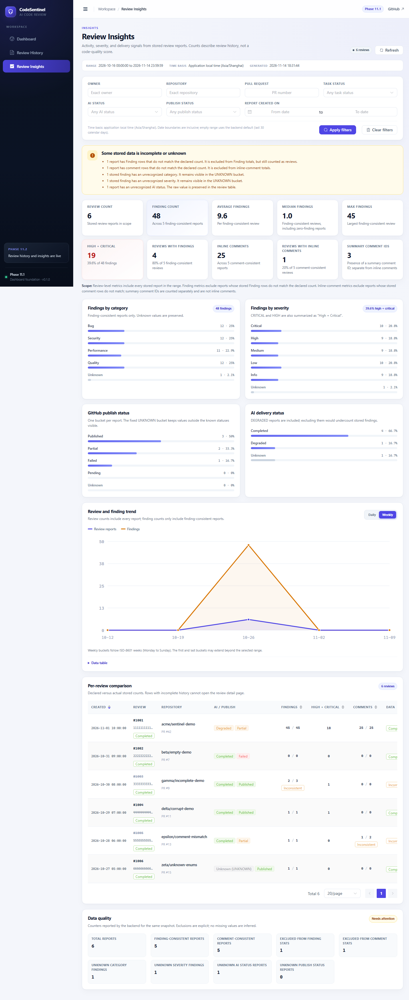

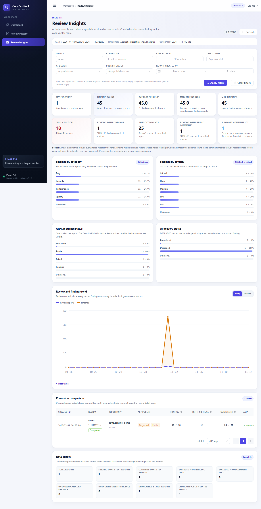

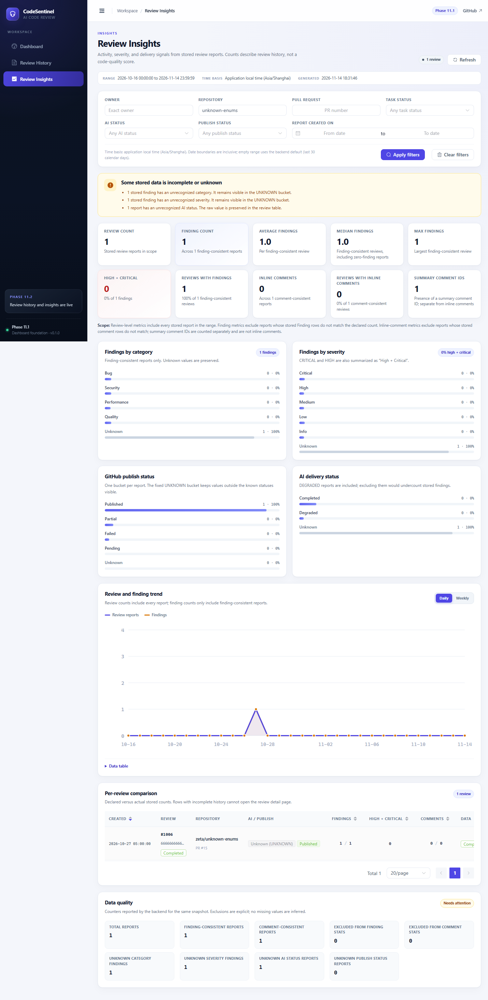

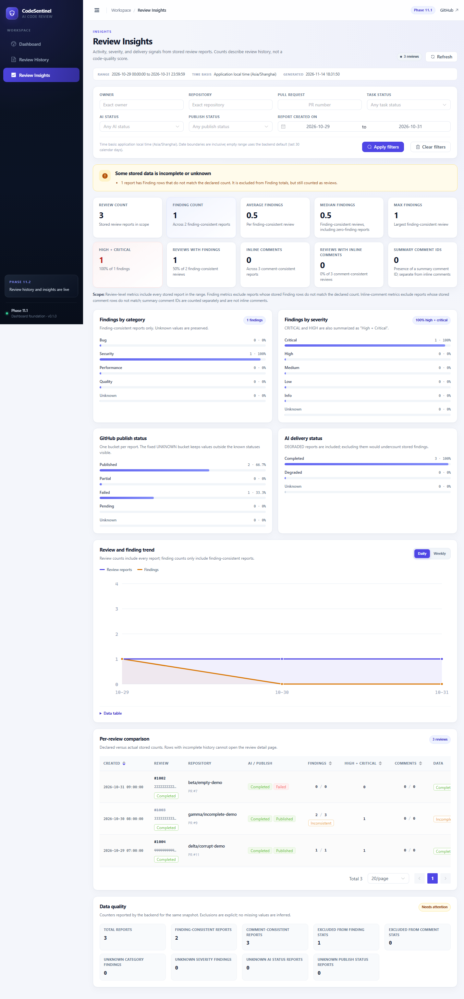

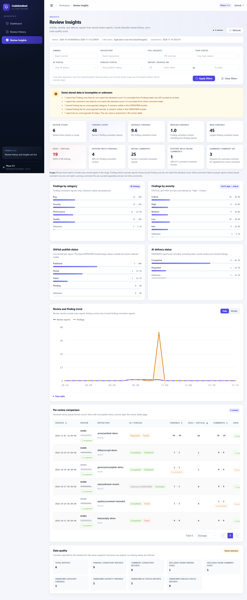

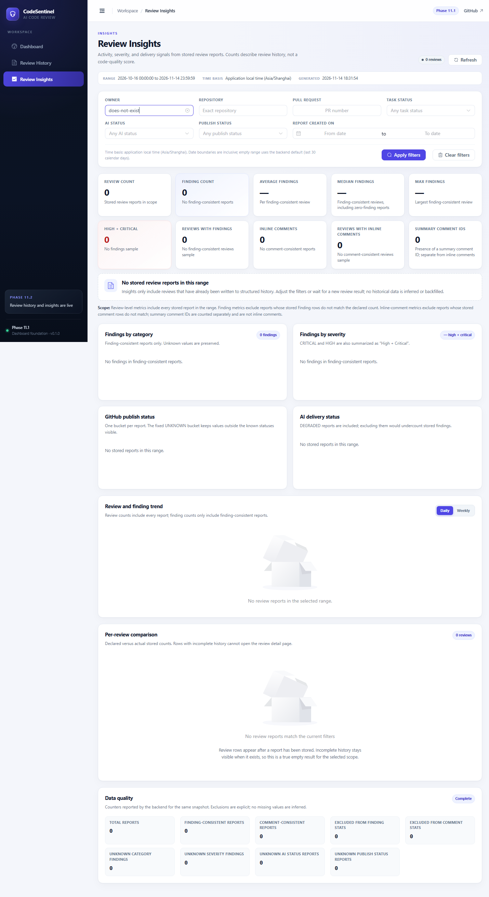

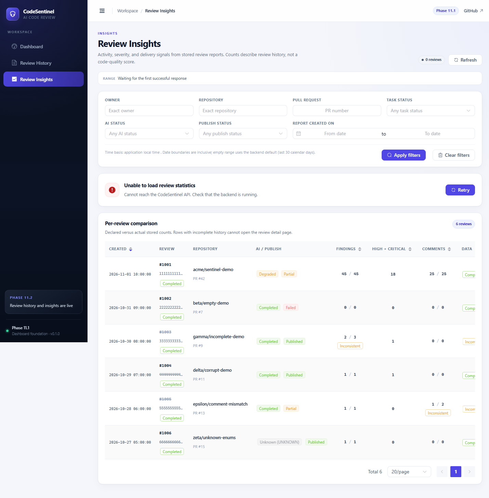

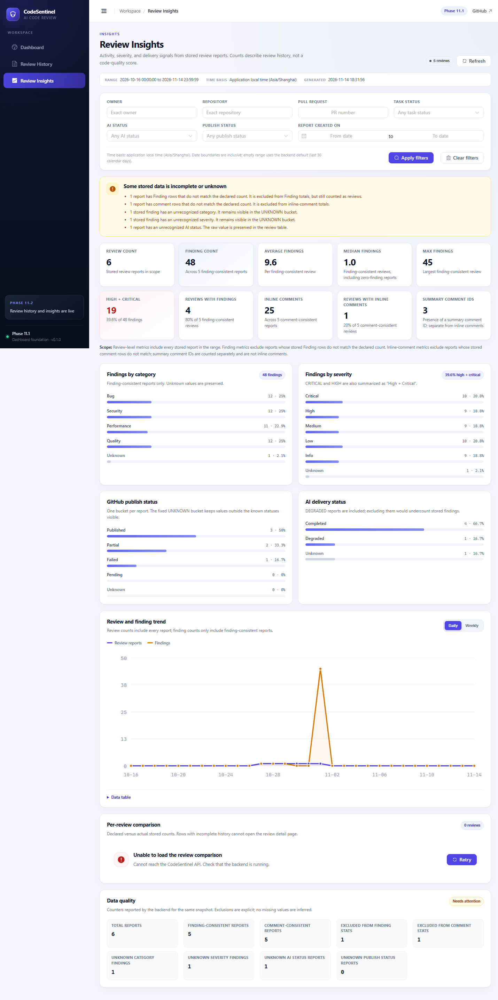

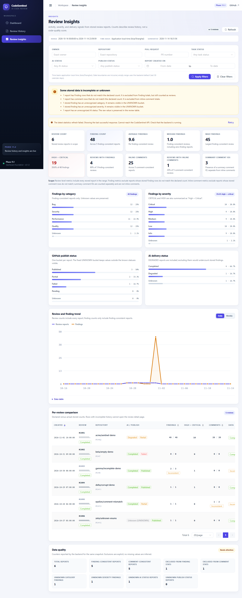

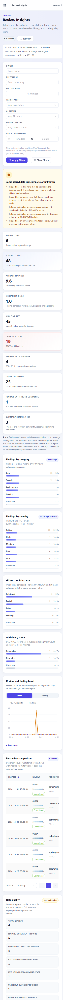

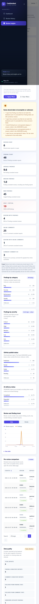

### 7.4 浏览器网络与安全观察

```text
统计请求总数                     54
200 响应                         50
故意注入失败                     4（net::ERR_FAILED）
5xx 响应                         0
请求携带 X-Internal-Token        0
请求携带 Authorization           0
响应暴露 X-Internal-Token        0
非 127.0.0.1:5173 跨域请求       0
localStorage / sessionStorage    无 token-like 值
Cookie                           无 token-like 值
正常流程非注入 console error     0
```

页面文本未出现：

```text
SQLSyntaxErrorException
java.lang.
at cn.codesentinel
review_report
review_finding
jdbc:
X-Internal-Token
```

### 7.5 真实翻页限制（NOT VERIFIED）

- UI 每页数量最小为 **10**，验收库只有 **6** 行，因此无法在页面上产生第 2 页。
- 已验证：分页组件渲染、Total 6、第 1 页、上一页 / 下一页禁用、10/20/50/100 选项、选择 10/page 后请求 `size=10` 且 6 行保留。
- 已通过 API 独立验证后端翻页：`page=2&size=2` → 200、totalItems 6、totalPages 3、第一行 task 1003。
- **真实 UI 翻页（点击第 2 页）标记为 NOT VERIFIED，不计入“已通过”。**

---

## 8. 安全边界验收

### 8.1 默认端口（8080）

- 请求用例：32 个（loopback 14，非 loopback 18）。
- 检查项：367 项，**367/367 通过**。
- 非 loopback 地址：`172.20.10.5`（真实网卡地址，非伪造头）。
- 检查内容包括 320 项响应体敏感信息扫描（32 用例 × 10 个关键字）和 32 项 `X-Internal-Token` 响应头检查。

| 场景 | 结果 |
|---|---|
| loopback `/actuator/health` | 200 |
| 非 loopback `/actuator/health` | 200（非 Dashboard 路径不受过滤器影响） |
| loopback `/api/dashboard/statistics/overview` | 200 |
| 非 loopback `/api/dashboard/statistics/overview` | 403，空响应体 |
| 非 loopback + `X-Forwarded-For: 127.0.0.1` | 403，不信任转发头 |
| 非 loopback + `X-Real-IP: 127.0.0.1` | 403 |
| 非 loopback + `Forwarded: for=127.0.0.1` | 403 |
| 非 loopback + `Host: localhost:8080` | 403 |
| loopback + 伪造转发头 | 200（仍按真实 peer 判断） |
| 非 loopback `/api/dashboard`、`/api/dashboard/` | 403 |
| 非 loopback 矩阵参数 `;x=1` | 403 |
| 非 loopback 编码 `/api/%64ashboard/...` | 403 |
| 非 loopback 编码矩阵 `%3B` | 403 |
| 非 loopback 双斜杠 / `.` / `..` | 403 |
| 非 loopback 反斜杠 / 编码斜杠 / null byte | 400（容器拒绝，非 200） |
| loopback 矩阵参数 / 编码 dashboard / 尾部矩阵参数 | 200（正常路由） |
| loopback 编码矩阵 / 双斜杠 / `.` / `..` | 404（未被规范化绕过） |
| 非 loopback `/api/dashboard-other` | 404，不被 Dashboard 过滤器误伤 |
| 非 loopback `/api/reviews/7` | 401，Phase 10 API 不被 Dashboard 过滤器误伤 |
| 非法 granularity | 400，`{"error":"invalid_granularity"}` |
| 非法 sort | 400，`{"error":"invalid_sort"}` |
| Dashboard 未知路径 | 404 |
| POST overview | 405 |
| 任一响应携带 `X-Internal-Token` | 0 |

### 8.2 Context path 复验（8081 + `/sentinel`）

- 实际启动 `SERVER_SERVLET_CONTEXT_PATH=/sentinel`，端口 8081。
- 请求用例：33 个；检查项：378 项，**378/378 通过**。
- 非 loopback 同样使用 `172.20.10.5`。

结果与默认端口一致：

```text
/sentinel/actuator/health                     loopback 200 / 非 loopback 200
/sentinel/api/dashboard/statistics/overview    loopback 200 / 非 loopback 403
非 loopback + Forwarded / Host 伪造            403
非 loopback 编码 / 矩阵 / 双重斜杠 / 点段      403
非 loopback 反斜杠 / 编码斜杠 / null byte      400
loopback 合法变体                              200
loopback 编码矩阵 / 双斜杠 / 点段              404
/sentinel/api/dashboard-other                 404
/sentinel/api/reviews/7                       401
不带 context path 的 /api/dashboard/...        404
非法 granularity / sort                        400，错误体已脱敏
POST overview                                  405
任一响应携带 X-Internal-Token                  0
```

### 8.3 脱敏与日志

- 所有 400 / 403 / 404 / 405 响应体均不含 SQL、表名、`jdbc:`、Java 堆栈、密码或 Token。
- 320 + 330 项响应体敏感信息扫描全部通过。
- 后端运行日志、context path 日志、Vite 日志关键字扫描命中数为 0。
- 未在页面、响应头或浏览器存储中发现 `X-Internal-Token`。
- 未访问任何跨域主机；浏览器只请求 `127.0.0.1:5173` 同源路径。

---

## 9. 验收数据库前后对比

### 9.1 行数与校验和

| 表 | 验收前 | 验收后 | 验收前校验和 | 验收后校验和 |
|---|---:|---:|---:|---:|
| `review_report` | 6 | 6 | 1584414636 | 1584414636 |
| `review_finding` | 50 | 50 | 3605045795 | 3605045795 |
| `review_comment` | 26 | 26 | 1998274923 | 1998274923 |
| `review_task` | 7 | 7 | 1413214174 | 1413214174 |

- 验收库表数量始终为 4。
- 验收结束后验收库活动连接数为 0。
- 未执行 INSERT / UPDATE / DELETE / TRUNCATE / ALTER / CREATE / DROP。
- 未创建索引，未修改表结构。
- 验收库 IT 使用 Hikari `read-only=true` 与测试级 `@Transactional(readOnly=true)`。
- Testcontainers MySQL IT 使用独立临时数据库，不触及验收库。

### 9.2 只读操作清单

```text
SELECT COUNT(*)
CHECKSUM TABLE
SELECT ... FROM information_schema.tables / statistics / processlist
SHOW INDEX（通过 information_schema.statistics）
EXPLAIN
```

未执行任何写操作。

---

## 10. SQL EXPLAIN（只读）

### 10.1 执行计划

在验收库上对 B1 Repository 的三类查询执行只读 `EXPLAIN`：

| 查询 | 表 | type | key | rows | Extra |
|---|---|---|---:|---:|---|
| `REPORT_STATISTICS` | `review_report r` | ALL | NULL | 6 | Using where |
| `REPORT_STATISTICS` | `review_task t` | eq_ref | PRIMARY | 1 | NULL |
| `REPORT_STATISTICS` | `review_finding f` | ref | `uk_review_finding_report_ordinal` | 10 | Using index |
| `REPORT_STATISTICS` | `review_comment c` | ref | `uk_review_comment_report_finding` | 13 | Using index |
| `FINDING_AGGREGATES` | `review_report r` | ALL | NULL | 6 | Using where; Using temporary |
| `FINDING_AGGREGATES` | `review_task t` | eq_ref | PRIMARY | 1 | NULL |
| `FINDING_AGGREGATES` | `review_finding f` | ref | `uk_review_finding_report_ordinal` | 10 | NULL |
| `REPORT_STATISTICS_OWNER_ZETA` | `review_report r` | ALL | NULL（possible `uk_review_report_task`） | 6 | Using where |
| `REPORT_STATISTICS_OWNER_ZETA` | `review_task t` | eq_ref | PRIMARY | 1 | Using where |
| `REPORT_STATISTICS_OWNER_ZETA` | `review_finding f` | ref | `uk_review_finding_report_ordinal` | 10 | Using index |
| `REPORT_STATISTICS_OWNER_ZETA` | `review_comment c` | ref | `uk_review_comment_report_finding` | 13 | Using index |

### 10.2 索引盘点

验收库当前索引：

```text
review_report    PRIMARY(id)
review_report    uk_review_report_task(task_id)
review_task      PRIMARY(id)
review_finding   PRIMARY(id)
review_finding   uk_review_finding_report_ordinal(report_id, ordinal)
review_comment   PRIMARY(id)
review_comment   uk_review_comment_github_id(github_comment_id)
review_comment   uk_review_comment_report_finding(report_id, finding_ordinal)
```

没有：

```text
review_report.created_at 索引
review_task.owner / repo 索引
review_report.publish_status / ai_status 索引
```

### 10.3 结论与边界

- `review_report` 统计查询使用全表扫描（`type=ALL`），这与 B1 审计的 P3 L-01 一致。
- `FINDING_AGGREGATES` 还使用临时表（`Using temporary`），与按 report / severity 聚合有关。
- owner 过滤时 `review_task` 只能按主键 `eq_ref` 后 `Using where`，没有 owner / repo 索引。
- `/reviews` 的排序、分页仍在 Java 内存中完成（B1 审计 P3 L-02）。
- 验收库仅 6 行，`rows=6` 为估算值；**不能据此推断生产数据量下的性能**，本轮也不声称生产性能通过。
- 按验收规则，本轮未新增索引、未改 SQL、未执行任何 DDL。

---

## 11. 问题与修复记录（P0–P3）

### 11.1 汇总

| 等级 | 数量 | 处理 |
|---|---:|---|
| P0 | 0 | — |
| P1 | 0 | — |
| P2 | 0 | — |
| P3 | 5 | 记录，不阻塞验收 |
| 修复 | 0 | 本轮未修改任何代码 |

### 11.2 P3 记录

#### C-P3-01 真实 UI 翻页未验证

- **类型**：验证限制，不是产品缺陷。
- **证据**：验收库 6 行；页面最小每页数量 10；UI 无法产生第 2 页。API `page=2&size=2` 返回 200、3 页、第一行 1003。
- **影响**：无法在真实浏览器中点击第 2 页验证行内容切换。
- **处理**：标记 **NOT VERIFIED**；不伪造通过。后续若需要，可增加 10 行以上验收数据或临时下调测试页大小。

#### C-P3-02 `review_report.created_at` 无索引，统计查询全表扫描

- **类型**：性能 / 可扩展性，继承 B1 审计 L-01。
- **证据**：EXPLAIN 中 `review_report` 为 `type=ALL`；`information_schema.statistics` 中仅有 `PRIMARY(id)` 与 `uk_review_report_task(task_id)`。
- **影响**：当前 6 行可接受；数据量增长后，默认 30 天范围与 owner / repo 过滤可能变慢。
- **处理**：记录，不阻塞；按验收规则未改索引 / DDL。

#### C-P3-03 `/reviews` 在 Java 内存中排序、分页

- **类型**：性能 / 可扩展性，继承 B1 审计 L-02。
- **证据**：B1 实现报告与审计报告已记录；本轮 API 分页、排序行为正确，但未改为 SQL 分页。
- **影响**：当前 6 行可接受；大结果集下会拉取全部行并在内存排序。
- **处理**：记录，不阻塞；未改 B1 实现。

#### C-P3-04 验收库 IT 默认禁用

- **类型**：测试运行方式，继承 B1 审计 L-04。
- **证据**：标准 `-Pmysql-it verify` 不启用验收库测试；必须显式设置 `-Dcodesentinel.acceptance.db=true` 并指定 URL / 凭据。
- **影响**：普通 CI 不会自动覆盖真实验收库；本轮已显式执行 12/12。
- **处理**：记录；未改测试配置。

#### C-P3-05 范围条省略小数秒

- **类型**：显示细节。
- **证据**：API `createdTo=2026-11-14T23:59:59.999999`；页面范围条显示 `2026-11-14 23:59:59`，因为 B2 `formatDateTime` 去掉小数部分。
- **影响**：仅显示层；实际请求边界仍为 `.999999`，日期筛选包含边界正确。
- **处理**：记录；不修改 B2 格式化逻辑，避免超出 C 验收范围。

### 11.3 修复记录

```text
本轮未发现需要修复的 P0 / P1 / P2。
本轮未修改任何源代码、测试、配置、SQL、索引或既有报告。
```

---

## 12. 已知限制与 NOT VERIFIED

### 12.1 明确 NOT VERIFIED

| 项目 | 原因 |
|---|---|
| 真实 UI 第 2 页翻页 | 验收库 6 行，页面最小页大小 10；后端 API 已单独验证 |
| 生产数据量下的查询性能 | 仅 6 行验收数据；EXPLAIN 是估算，不做生产性能结论 |
| 浏览器 UI 的 403 错误文案 | 非 loopback 403 已在 API 层验证；浏览器 E2E 只从 loopback 运行。B2 单测覆盖 403 映射，但本轮未做真实浏览器 403 页面验证 |
| 生产构建产物的浏览器 E2E | E2E 运行在 Vite dev server；`npm run build` 已独立通过 |
| 真机移动端 / 多浏览器 | 仅 Chrome 157 headless + 390×844 视口模拟；未测 Firefox / Safari / Edge / 真机 |
| context path 下的浏览器 UI | `/sentinel` 做了真实 HTTP 安全复验，未在浏览器中加载 context path 页面 |
| 截图完整高度 | 11/12 为 6000 px 全页截图上限；窄屏页面底部若超过上限可能被截断 |

### 12.2 其他限制

1. **数据规模小**：验收库只有 6 个 report，无法覆盖大分页、深翻页、长期趋势和索引选择性。
2. **单一环境**：只在本机 Windows 11、单 MySQL 实例、`Asia/Shanghai` 时区下验证。
3. **失败注入方式**：浏览器失败通过 CDP 网络拦截模拟，不是停止后端进程或破坏数据库；B / B1 / B2 已有后端不可用和数据库故障专项。
4. **未做压力测试**：没有并发用户、持续请求、慢查询或连接池压力测试。
5. **未验证 GitHub / LLM / Redis 链路**：本阶段统计只读 MySQL，不触发 GitHub API、LangGraph 或 DeepSeek。
6. **工作区仍是脏的**：验收开始前已有大量未提交 / 未跟踪文件；按用户要求未清理、未提交。
7. **未更新 `docs/DEVELOPMENT_STATUS.md`**：按用户要求保持现状。
8. **未进入 Phase 12**：本报告是 C 阶段停点，不包含后续功能。

---

## 13. 最终结论与停点

### 13.1 最终判定

**PASS WITH WARNINGS。**

Phase 11.2.4-C 的 B1 统计 API、B2 Insights 页面、真实 MySQL 数据、真实浏览器流程和安全边界均达到验收要求：

- 后端 541 个单元测试、76 个 IT（含 12 个验收库定向测试）全部通过；
- 前端 121 个单元测试、类型检查、Lint、生产构建全部通过；
- 真实 API 28 个场景 / 155 项检查全部通过；
- 真实浏览器 20 个场景 / 141 项检查全部通过，12 张截图留证；
- 默认端口 367 项、context path 378 项安全检查全部通过；
- 验收数据库前后完全一致，未执行 DDL/DML；
- 未发现 P0 / P1 / P2 缺陷，未修改任何源代码；
- 唯一未验证的功能点是真实 UI 翻页，已明确标记 **NOT VERIFIED**，后端分页已通过 API 验证。

### 13.2 停点声明

- **不进入 Phase 12。**
- **不执行任何 Git 写操作**（commit / push / merge / rebase / reset / clean / checkout / stash）。
- **不修改 `docs/DEVELOPMENT_STATUS.md`。**
- **不清理工作区，不删除既有改动。**
- 等待人工验收与下一步指令。

---

## 附录 A：验收证据文件

以下文件位于工作区外临时目录，供复核：

```text
<temp-dir>\phase11_2_4_c\
├── api-integration-checks.json          155 项 API 检查
├── api-integration-results.json         28 个 API 场景原始结果
├── api-integration.ps1                  API 验收脚本
├── security-checks.json                 367 项默认端口安全检查
├── security-results.json                32 个安全请求用例
├── security-check.ps1                   默认端口安全脚本
├── security-context-path-checks.json    378 项 context path 检查
├── security-context-path-results.json   33 个 context path 请求用例
├── security-context-path.ps1            context path 安全脚本
├── explain.txt                          只读 EXPLAIN 输出
├── e2e-cdp.mjs                          CDP 浏览器 E2E 脚本
├── e2e-run.log                          E2E 运行日志
├── e2e/e2e-results.json                 20 场景 / 141 检查 / 网络与控制台
├── e2e/e2e-summary.json                 E2E 摘要
├── e2e/screenshots/                     12 张原始截图
├── backend-run.log                      8080 后端日志
├── backend-context-path.log             8081 context path 日志
└── vite-dev.log                         Vite 日志
```

仓库内截图副本：

```text
docs/reports/assets/phase11_2_4_c/
```
